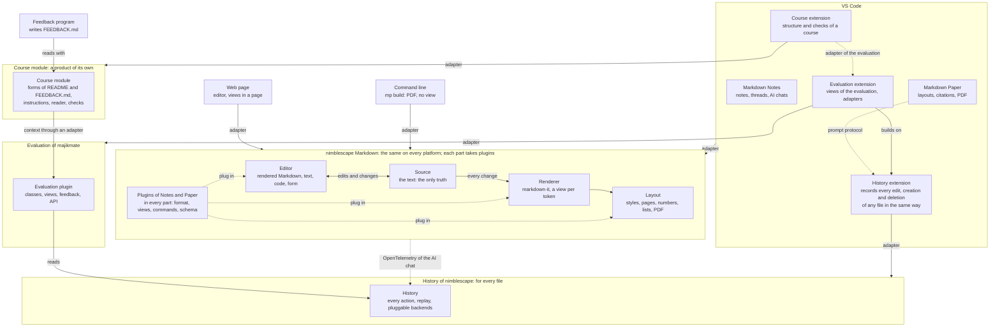

<!--
SPDX-License-Identifier: MIT
© 2026 Hannes Stauss (scalarion@nimblescape.com)
Licensed under the MIT License. See LICENSE in the repository root for details.
-->

# Specification

This specification defines nimblescape Markdown: general libraries that
keep, edit, render and lay out text documents, Markdown first, on several
platforms, and the plugins that build on them. This document gives the
scope, the terms, the architecture, the rules for libraries, licenses and
release, and the plan; each part has a document of its own
([section 4](#4-documents)). The specification is normative. "Must" marks a
requirement, "should" a recommendation, and "may" an option. A requirement
marked *(proposal)* is not decided yet; each document that has such
requirements lists its open questions, with the proposal for each, in its
last section. Each requirement has an ID as its heading, so that code, tests
and pull requests can link to it, for example
`[R-GEN-001](docs/specification.md#r-gen-001)`. The ID of a requirement
stays the same when the requirement moves to another document, and the table
of [section 4](#4-documents) shows the document of each ID. The
[plan](#plan) at the end shows the steps of the build and their state.

## 1. Scope

### R-GEN-001

**General libraries for text documents.** nimblescape Markdown is a set of
general libraries for text documents. Markdown is the first format. The
source and the platforms also work for any other text, for example source
code. The history is a product of its own that serves every file, not only
Markdown, and the evaluation of majikmate builds on it
([R-ARCH-003](#r-arch-003)). The target
platforms are VS Code and the web, with the same code; the command line is a
platform for output without a view, for example `mp build` of nimblescape
Markdown Paper. Today the libraries are one npm package,
`@nimblescape/markdown` ([R-ARCH-002](#r-arch-002)). nimblescape Markdown
Notes and nimblescape Markdown Paper are format extensions: they add their
parts through plugins ([plugins and format extensions](plugins.md)), and
they decide where they use the libraries
([R-GEN-004](platforms.md#r-gen-004)).

## 2. Terms

| Term | Meaning |
| --- | --- |
| Source | The text of a file, the selections in it, and the changes to it |
| Editor | A part that shows the text in a form that the user changes |
| Renderer | A part that turns the text into content without edit functions |
| Layout | A part that puts rendered content into a layout: styles, templates, pages, PDF |
| History | The recorder of every action on any file, a product of its own ([R-ARCH-003](#r-arch-003)): it saves the actions and replays them |
| Backend | A plugin of the history that stores the steps of a history and reads them back |
| Platform adapter | The code that connects the libraries to one platform, for example VS Code |
| Plugin | An object that adds functions to one part |
| Format extension | The plugins of one file format for all parts, for example Markdown Notes |
| Step | One recorded action of the history |
| Origin | Who made a change: the user, the AI, or another program |

## 3. Architecture

| Part | What it does |
| --- | --- |
| Source | Holds the text of a file and the selections. Applies each change as a text patch with its origin, and sends it to the other parts. |
| Editor | Shows the text in a form that the user edits, and turns each edit into a change of the text. |
| Renderer | Turns the text into content without edit functions: HTML, with a view for each kind of token. |
| Layout | Puts the content of the renderer into a layout: styles, title page and templates, numbers, generated lists, pages, PDF. |
| Platform | Connects the libraries to one platform, and decides how each function is shown and used there. |

Every edit, in any editor and by the AI, becomes a change of the text in the
source, which sends it to the renderer and to every other listener. The
history is a product of its own beside these parts, and the evaluation of
majikmate builds on it ([R-ARCH-003](#r-arch-003)). In VS Code, the history
extension ([R-VSC-004](history.md#r-vsc-004)) records every edit, creation
and deletion of any file in the workspace, whatever editor made it; Markdown
Notes and Markdown Paper need it for no file, and the evaluation extension
shows the evaluation ([R-EVAL-017](evaluation.md#r-eval-017)). The course
module is a product of its own too ([R-ARCH-004](#r-arch-004)): it gives the
evaluation the context of a course through an adapter
([R-EVAL-021](evaluation.md#r-eval-021)).

### R-GEN-015

**Five pluggable parts.** nimblescape Markdown must consist of the five
parts of the table above, and each part must take plugins. The functions and
their state must be in the libraries, the same on every platform; no part
except the platform adapter may use an API of a platform directly. The
platform adapter must stay thin: it connects the libraries to the views,
commands, settings and storage of its platform, and it decides how a
function is shown and used. For example, the threads of notes show in the
side view of Notes in VS Code and as icons beside the text on a web page
([R-GEN-014](editor.md#r-gen-014)).

### R-ARCH-001

**The text is the only truth.** The text of the file is the single
authoritative state. Every change, by the user in any editor, by the AI or
by another program, must be a change of the text, applied through the
source. The source must send every change to all open editors and renderers
and to every other listener, for example a history.

### R-GEN-010

**One rendering.** The rendering code must exist once: the rendered view in
the editor, the pages and the PDF must use the same views of the same
plugins. The editor must be built on the renderer: it shows each block with
the view of the renderer and adds the edit functions; the renderer and the
layout run without the editor.

### R-ARCH-002

**Names of the npm packages.** The name of each npm package of the libraries
must start with `markdown` in the scope `@nimblescape`, without a hyphen, in
the same way as `@nimblescape/markdownnotes`.

**One npm package for each part.** The libraries must have one npm package
for each part: `@nimblescape/markdowntext` (source),
`@nimblescape/markdowneditor` (the editor API and the rendered Markdown
editor), `@nimblescape/markdownrender` (renderer),
`@nimblescape/markdownlayout` (layout, pages, PDF), and one package for each
platform, `@nimblescape/markdownvscode` and `@nimblescape/markdownweb`.
Until the API between the parts reaches version 1, all packages must live in
this repository as npm workspaces.

### R-ARCH-003

**The history is general infrastructure; the evaluation builds on it.** The
history recorder must be a product of its own of nimblescape, not a part of
nimblescape Markdown: it serves every file, not only Markdown. It has one
repository and one VS Code extension, the history extension, which records
every edit of any file in the workspace and every creation and deletion of a
file ([R-VSC-004](history.md#r-vsc-004)). The source of nimblescape Markdown
needs the history for no file; its AI chat reports its actions like any
other AI tool ([R-HIST-010](history.md#r-hist-010)). The name of the tool
must not be `history`, because its folder `.history/`
([R-GEN-007](#r-gen-007)) is the folder of the VS Code extension "Local
History", and the gitignore template of GitHub for Visual Studio lets Git
ignore it. The name of the tool is `workhistory`, with the folder
`.workhistory/`: the repository is `nimblescape/workhistory-vscode`, in the
form of the other nimblescape extensions with an npm package, and its npm
package is `@nimblescape/workhistory`, in the same way as the names of the
packages of nimblescape Markdown start with `markdown`. The evaluation of
the history is a product of majikmate that builds on the history
([R-ARCH-005](#r-arch-005)): it reads the history through its API and its
file form, and it has its own repository, VS Code extension and npm package
([R-EVAL-017](evaluation.md#r-eval-017)). Until the repositories exist, the
documents of the history and of the evaluation stay in this repository.

### R-ARCH-004

**The course module is a product of its own.** The course module defines the
form of the files of a course in a repository, its README files and its
feedback files, with a comment of the format and instructions for AI agents,
and it reads these files as structured data
([R-COURSE-001](course.md#r-course-001)). It is a product of its own, not a
part of nimblescape Markdown or of the history: the repository
`majikmate/course-vscode`, the npm package `@majikmate/course` and the
folder `.course/` ([R-COURSE-002](course.md#r-course-002)). It is the
adapter of a course for the evaluation
([R-COURSE-003](course.md#r-course-003)). Until the repository exists, its
document stays in this repository.

### R-ARCH-005

**Owners of the products.** nimblescape provides general infrastructure;
majikmate provides the academic context and builds on the infrastructure of
nimblescape. So nimblescape owns the libraries of nimblescape Markdown,
Markdown Notes and the history, and majikmate owns Markdown Paper, the
evaluation and the course module: their repositories are
`majikmate/markdownpaper-vscode`, `majikmate/workevaluation-vscode`
([R-EVAL-017](evaluation.md#r-eval-017)) and `majikmate/course-vscode`. A
product of majikmate may depend on a product of nimblescape, and a product
of nimblescape does not depend on a product of majikmate: the history
records the files of Markdown Notes like any other file
([R-VSC-004](history.md#r-vsc-004)), and it knows no evaluation.
*(proposal)* The scope of the npm packages and the publisher of the VS Code
extensions follow the owner, for example `@majikmate/markdownpaper`. Until
the repository of Markdown Paper moves to majikmate, its address stays
`nimblescape/markdownpaper-vscode`, and GitHub forwards the old address
after the move.

## 4. Documents

Each part of [section 3](#3-architecture) has a document of its own, except
the renderer and the layout, which share one document; the plugins of the
format extensions, the AI and the platforms have documents of their own too.
The history and the evaluation are products of their own
([R-ARCH-003](#r-arch-003)); their documents stay here until they have
repositories of their own. The same holds for the course module
([R-ARCH-004](#r-arch-004)).

| Document | Content | Requirements |
| --- | --- | --- |
| [Specification](specification.md), this document | Scope, terms, architecture, libraries, licenses and release, plan | [R-GEN-001](#r-gen-001), [R-GEN-015](#r-gen-015), [R-ARCH-001](#r-arch-001), [R-GEN-010](#r-gen-010), [R-ARCH-002](#r-arch-002), [R-ARCH-003](#r-arch-003), [R-ARCH-004](#r-arch-004), [R-ARCH-005](#r-arch-005), [R-GEN-011](#r-gen-011), [R-GEN-007](#r-gen-007) |
| [Source](source.md) | The text, the selections and the changes; the formats of the front matter and of the files | [R-SRC-001](source.md#r-src-001) to [R-SRC-003](source.md#r-src-003), [R-GEN-006](source.md#r-gen-006) |
| [Editor](editor.md) | The editors of a file and the rendered Markdown editor: the round trip, the interaction, tables, the read-only mode and the read-only generated parts, the mode to learn Markdown, the form of the front matter, threads beside the text | [R-GEN-002](editor.md#r-gen-002), [R-EDIT-001](editor.md#r-edit-001) to [R-EDIT-011](editor.md#r-edit-011), [R-GEN-009](editor.md#r-gen-009), [R-GEN-003](editor.md#r-gen-003), [R-GEN-008](editor.md#r-gen-008), [R-GEN-013](editor.md#r-gen-013), [R-FM-001](editor.md#r-fm-001) to [R-FM-006](editor.md#r-fm-006), [R-GEN-014](editor.md#r-gen-014) |
| [Renderer and layout](rendering.md) | The renderer: content without edit functions, plugins of the renderer. The layout: layouts, pages and PDF | [R-REN-001](rendering.md#r-ren-001) to [R-REN-003](rendering.md#r-ren-003), [R-LAYOUT-001](rendering.md#r-layout-001) to [R-LAYOUT-004](rendering.md#r-layout-004) |
| [History](history.md) | The recorder of every action on any file, a product of its own: steps, the API for actions, AI agents in cloud sessions, storage backends, back and forward, replay, the use of the history by plugins, the history extension of VS Code | [R-AI-004](history.md#r-ai-004), [R-HIST-001](history.md#r-hist-001) to [R-HIST-008](history.md#r-hist-008), [R-HIST-010](history.md#r-hist-010), [R-HIST-011](history.md#r-hist-011), [R-VSC-004](history.md#r-vsc-004) |
| [Evaluation plugin](evaluation.md) | The evaluation of a history, a product of majikmate that builds on the history: classes and roles of the work, evaluation, views, feedback, assignments, API, the package and the extension, scientific basis | [R-EVAL-001](evaluation.md#r-eval-001) to [R-EVAL-021](evaluation.md#r-eval-021) |
| [Course module](course.md) | The course module, a product of its own: the form of the README files and of the feedback files of a course, the comment of the format, the instructions for AI agents, the structured reading, the checks and the adapter of the evaluation | [R-COURSE-001](course.md#r-course-001) to [R-COURSE-012](course.md#r-course-012), [R-FEED-001](course.md#r-feed-001) to [R-FEED-004](course.md#r-feed-004) |
| [How the evaluation works](evaluation-guide.md) | The documentation of the evaluation: how it works, step by step, with the scientific basis of each step; the report links to it and cites no literature | Documentation of [R-EVAL-020](evaluation.md#r-eval-020) |
| [Plugins and format extensions](plugins.md) | The plugin API, the levels of a plugin, the plugins of Markdown Notes and Markdown Paper | [R-GEN-005](plugins.md#r-gen-005), [R-GEN-012](plugins.md#r-gen-012), [R-PLUGIN-001](plugins.md#r-plugin-001), [R-NOTES-001](plugins.md#r-notes-001), [R-PAPER-001](plugins.md#r-paper-001) |
| [AI](ai.md) | AI chats, tracked changes, pluggable providers, the API key, the memory | [R-AI-001](ai.md#r-ai-001), [R-AI-006](ai.md#r-ai-006), [R-AI-002](ai.md#r-ai-002), [R-AI-005](ai.md#r-ai-005), [R-AI-003](ai.md#r-ai-003) |
| [Platforms](platforms.md) | The adapters of VS Code, of the web and of the command line; the theme | [R-PLAT-001](platforms.md#r-plat-001), [R-GEN-004](platforms.md#r-gen-004), [R-VSC-001](platforms.md#r-vsc-001) to [R-VSC-003](platforms.md#r-vsc-003), [R-WEB-001](platforms.md#r-web-001), [R-CLI-001](platforms.md#r-cli-001), [R-THEME-001](platforms.md#r-theme-001) to [R-THEME-003](platforms.md#r-theme-003) |

## 5. Libraries, licenses and release

### R-GEN-011

**Available libraries first.** The libraries must use existing open-source
libraries wherever one fits. Own code stays for what no library does. The
license of each library is decided one by one. The file `licenses.json`
lists each package that the libraries need at run time with its decided
license, and CI fails for a package or a license that the file does not
list. The notices go with every bundle. The license of the nimblescape
libraries, MIT today, may change when a library needs it. The libraries in
use:

| Library | License | Use |
| --- | --- | --- |
| Tiptap 3 (`@tiptap/core`, `@tiptap/pm`, `@tiptap/starter-kit` and the `@tiptap/extension-*` packages of the nodes and marks) | MIT | The rendered editor and its extension API |
| ProseMirror, through `@tiptap/pm` | MIT | The engine of the rendered editor ([R-GEN-009](editor.md#r-gen-009)) |
| markdown-it, `markdown-it-footnote` | MIT | Parsing and rendering of Markdown |
| `markdown-it-task-lists` | ISC | Task lists |
| `prosemirror-markdown` | MIT | The bridge between the tokens of markdown-it and the document of the editor |
| `string-width` | MIT | The width of the cells of a table |

### R-GEN-007

**Rules of all nimblescape repositories:**

- The specification is a clean summary: each decision becomes a requirement
  in the document of its part, in the same change, without the texts of the
  discussion.
- Code and documents use English terms.
- Nothing is published before the release: no version of an npm package on
  npmjs.com, no version of an extension on the Marketplace, no release tag.
  Other repositories install a package from its GitHub repository at a fixed
  commit.
- The npm packages use the same structure, build and release workflow as the
  other nimblescape npm packages.
- A tool keeps the files that it writes into a repository in a folder with
  the name of the tool and a leading dot, for example `.markdownpaper/` of
  Markdown Paper, `.markdownnotes/` of Markdown Notes, `.workhistory/` of
  the history and `.course/` of the course module, and not in a shared folder
  such as `.nimblescape/`. The name
  of a tool must give a folder that no other common tool uses.

## 6. Open questions

1. Names: the contribution point `nimblescape.markdown.extensions`
   (proposal)?
2. Licenses: `markdown-it-task-lists` (ISC), `entities` (BSD-2-Clause, used
   by markdown-it) and `argparse` (Python-2.0, only in the command line
   program of markdown-it, in no bundle).

The documents of the parts list their own open questions: the
[editor](editor.md#10-open-questions), the
[renderer and the layout](rendering.md#5-open-questions), the
[history](history.md#6-open-questions), the
[evaluation plugin](evaluation.md#9-open-questions), the
[plugins](plugins.md#5-open-questions), the [AI](ai.md#4-open-questions) and
the [platforms](platforms.md#6-open-questions).

## Plan

| Step | Content | Requirements | State |
| --- | --- | --- | --- |
| 1 | Setup of the repository: the npm package, an example page for the web, CI with a check of the licenses | [R-GEN-007](#r-gen-007), [R-GEN-011](#r-gen-011) | built |
| 2 | The core on ProseMirror: Markdown into the document of the editor and back, with tests of the round trip | [R-GEN-009](editor.md#r-gen-009), [R-SRC-003](source.md#r-src-003), [R-EDIT-004](editor.md#r-edit-004) to [R-EDIT-006](editor.md#r-edit-006) | built |
| 3 | Rendered editing of CommonMark and GFM: toolbar, format bar, insert menu, slash menu, block handles, find and replace, read-only mode, the mode to learn Markdown | [R-EDIT-003](editor.md#r-edit-003), [R-GEN-003](editor.md#r-gen-003), [R-EDIT-007](editor.md#r-edit-007), [R-GEN-008](editor.md#r-gen-008), [R-GEN-013](editor.md#r-gen-013) | planned |
| 4 | Tables: handles, markers for new rows and columns, the table menu | [R-EDIT-008](editor.md#r-edit-008) to [R-EDIT-010](editor.md#r-edit-010) | planned |
| 5 | The form of the front matter with both modes and the JSON schema | [R-FM-001](editor.md#r-fm-001) to [R-FM-006](editor.md#r-fm-006) | planned |
| 6 | The adapter for the webviews of VS Code and the theme of VS Code | [R-GEN-004](platforms.md#r-gen-004), [R-VSC-001](platforms.md#r-vsc-001) to [R-VSC-003](platforms.md#r-vsc-003), [R-THEME-001](platforms.md#r-theme-001) | planned |
| 7 | The plugin API, version 1, with both levels of plugins; the read-only generated parts; the icons of threads beside the text | [R-GEN-005](plugins.md#r-gen-005), [R-GEN-012](plugins.md#r-gen-012), [R-PLUGIN-001](plugins.md#r-plugin-001), [R-EDIT-011](editor.md#r-edit-011), [R-GEN-014](editor.md#r-gen-014) | planned |
| 8 | The plugins of nimblescape Markdown Notes, in its repository; the editor in the Notes side view | [R-NOTES-001](plugins.md#r-notes-001), [R-GEN-002](editor.md#r-gen-002), [R-GEN-004](platforms.md#r-gen-004) | planned |
| 9 | The plugins of nimblescape Markdown Paper, in its repository; the schema of each layout | [R-PAPER-001](plugins.md#r-paper-001), [R-FM-004](editor.md#r-fm-004) | planned |
| 10 | The provider API, the Claude provider and the proposed changes in the editor; in Notes, the AI chat as notes and the memory; the OpenTelemetry events of the AI chat | [R-AI-001](ai.md#r-ai-001) to [R-AI-003](ai.md#r-ai-003), [R-AI-005](ai.md#r-ai-005), [R-AI-006](ai.md#r-ai-006), [R-AI-004](history.md#r-ai-004), [R-EDIT-001](editor.md#r-edit-001) | planned |
| 11 | The release workflow of the npm packages, the same as for the other nimblescape npm packages | [R-GEN-007](#r-gen-007) | planned |

The parts of [section 3](#3-architecture) that the plan does not name yet
get their steps in the plan: the npm workspaces of
[R-ARCH-002](#r-arch-002), the source, the renderer and the layout before
step 3 starts. The history and the evaluation plugin get their plans in
their own repositories ([R-ARCH-003](#r-arch-003)); this plan holds only the
OpenTelemetry events of the AI chat of nimblescape Markdown (step 10), which
the history reads like those of other AI tools.

---

© 2026 Hannes Stauss (scalarion@nimblescape.com) ·
[MIT License](https://github.com/nimblescape/markdown/blob/main/LICENSE).
