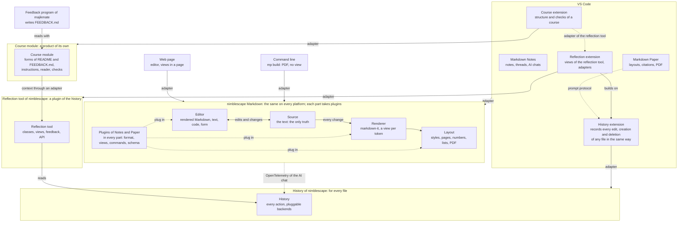

<!--
SPDX-License-Identifier: MIT
© 2026 Hannes Stauss (scalarion@nimblescape.com)
Licensed under the MIT License. See LICENSE in the repository root for details.
-->

# Specification

This specification defines nimblescape Markdown: general libraries that
keep, edit, render and lay out text documents, Markdown first, on several
platforms, and the plugins that build on them. This document gives the
scope, the terms, the architecture, and the rules for libraries, licenses and
release; each part has a document of its own
([section 4](#4-documents)). The specification is normative. "Must" marks a
requirement, "should" a recommendation, and "may" an option. A requirement
marked *(proposal)* is not decided yet; each document that has such
requirements lists its open questions, with the proposal for each, in its
last section. Each requirement has an ID as its heading, so that code, tests
and pull requests can link to it, for example
`[R-GEN-001](docs/specification.md#r-gen-001)`. The ID of a requirement
stays the same when the requirement moves to another document, and the table
of [section 4](#4-documents) shows the document of each ID. The Claude
document [One plan of all products](https://claude.ai/artifact/SatbygA2FkJiW3ob623NEy) is the one plan: it lists the
decisions that wait for the owner, each with a short description and a
recommendation. The built steps 1 to 18 of the libraries keep their numbers; their list is in the
[last version of the plan file](https://github.com/nimblescape/markdown/blob/23c2c0a/docs/plan.md#71-nimblescape-markdown-the-libraries) in
the history of this repository.

## 1. Scope

### R-GEN-001

**General libraries for text documents.** nimblescape Markdown is a set of
general libraries for text documents. Markdown is the first format. The
source and the platforms also work for any other text, for example source
code. The history is a product of its own that serves every file, not only
Markdown, and the reflection tool builds on it
([R-ARCH-003](#r-arch-003)). The target
platforms are VS Code and the web, with the same code; the command line is a
platform for output without a view, for example `mp build` of nimblescape
Markdown Paper. The libraries are npm packages, one for each part
([R-ARCH-002](#r-arch-002)): `@nimblescape/markdowntext`,
`@nimblescape/markdownai`, `@nimblescape/markdownrender`,
`@nimblescape/markdownlayout` and `@nimblescape/markdowneditor`. The adapter
of a platform is a part of the product that uses the editor there, for
example the adapter of VS Code in nimblescape Markdown Notes.
nimblescape Markdown
Notes and nimblescape Markdown Paper are format extensions: they add their
parts through plugins ([plugins and format extensions](plugins.md)), and
they decide where they use the libraries
([R-GEN-004](platforms.md#r-gen-004)).

## 2. Terms

| Term | Meaning |
| --- | --- |
| Source | The text of a file, the selections in it, and the changes to it |
| Editor | A part that shows the text in a form that the user changes |
| Renderer | A part that turns the text into content without edit functions |
| Layout | A part that puts rendered content into a layout: styles, templates, pages, PDF |
| History | The recorder of every action on any file, a product of its own ([R-ARCH-003](#r-arch-003)): it saves the actions |
| Backend | A plugin of the history that stores the steps of a history and reads them back |
| Platform adapter | The code that connects the libraries to one platform, for example VS Code |
| Plugin | An object that adds functions to one part |
| Format extension | The plugins of one file format for all parts, for example Markdown Notes |
| Step | One recorded action of the history |
| Origin | Who made a change: the user, the AI, or another program |

## 3. Architecture

| Part | What it does |
| --- | --- |
| Source | Holds the text of a file and the selections. Applies each change as a text patch with its origin, and sends it to the other parts. |
| Editor | Shows the text in a form that the user edits, and turns each edit into a change of the text. |
| Renderer | Turns the text into content without edit functions: HTML, with a view for each kind of token. |
| Layout | Puts the content of the renderer into a layout: styles, title page and templates, numbers, generated lists, pages, PDF. |
| Platform | Connects the libraries to one platform, and decides how each function is shown and used there. |

Every edit, in any editor and by the AI, becomes a change of the text in the
source, which sends it to the renderer and to every other listener. The
history is a product of its own beside these parts, and the reflection tool
builds on it ([R-ARCH-003](#r-arch-003)). In VS Code, the
history extension ([R-VSC-004](history.md#r-vsc-004)) records every edit,
creation and deletion of any file in the workspace, whatever editor made it;
Markdown Notes and Markdown Paper need it for no file, and the reflection
extension shows the analysis ([R-REFL-017](reflection.md#r-refl-017)). The
course module is a product of its own too ([R-ARCH-004](#r-arch-004)): it
gives the reflection tool the context of a course through an adapter
([R-REFL-021](reflection.md#r-refl-021)).

### R-GEN-015

**Five pluggable parts.** nimblescape Markdown must consist of the five
parts of the table above, and each part must take plugins. The functions and
their state must be in the libraries, the same on every platform; no part
except the platform adapter may use an API of a platform directly. The
platform adapter must stay thin: it connects the libraries to the views,
commands, settings and storage of its platform, and it decides how a
function is shown and used. For example, the threads of notes show in the
side view of Notes in VS Code and as icons beside the text on a web page
([R-GEN-014](editor.md#r-gen-014)).

### R-ARCH-001

**The text is the only truth.** The text of the file is the single
authoritative state. Every change, by the user in any editor, by the AI or
by another program, must be a change of the text, applied through the
source. The source must send every change to all open editors and renderers
and to every other listener, for example a history.

### R-GEN-010

**One rendering.** The rendering code must exist once: the rendered view in
the editor, the pages and the PDF must use the same views of the same
plugins. The editor must be built on the renderer: it shows each block with
the view of the renderer and adds the edit functions; the renderer and the
layout run without the editor.

*(proposal)* The editor reads the text with the markdown-it of its renderer,
and shows each block of the level "render" with its renderer and the
plugins ([R-GEN-012](plugins.md#r-gen-012)). The other blocks are nodes of
the editor; they have the styles of rendered content of the renderer
(`content.css`), the same as a rendering, so that the editor and the
rendering look the same.

### R-ARCH-002

**Names of the npm packages.** The name of each npm package of the libraries
must start with `markdown` in the scope `@nimblescape`, without a hyphen, in
the same way as `@nimblescape/markdownnotes`.

**One npm package for each part.** The libraries must have one npm package
for each part that is useful without the others:
`@nimblescape/markdowntext` (source), `@nimblescape/markdowneditor` (the
editor API and the rendered Markdown editor),
`@nimblescape/markdownrender` (renderer), `@nimblescape/markdownlayout`
(layout, pages, PDF) and `@nimblescape/markdownai` (AI), so that a product
installs only the parts that it uses: for example `mp build` of Markdown
Paper uses the renderer and the layout without the editor, and Markdown
Notes uses the editor without the layout. All packages have the same
version. Until the API between the parts reaches version 1, all packages
must live in this repository as npm workspaces.

**No package for a platform.** The libraries have no npm package for a
platform. The adapter of a platform is a part of the product that uses the
editor on that platform, for example the adapter of VS Code in Markdown
Notes ([the adapter of VS Code of Notes](https://github.com/nimblescape/markdownnotes-vscode/blob/main/docs/requirements.md#r-vsc-001)).

**The package of the AI.** The provider API, the context of the
document for the AI, the tool of the proposed changes and the loop of a chat
([AI](ai.md)) are the package `@nimblescape/markdownai`, without a view, so
that they run in the page, in the extension host of VS Code and on a
server. A provider of one AI, for example the Claude API, is a part of that
package with its own entry point.

*(proposal)* **Form of the workspaces.** Each package must live in the
folder `packages/<name>/` with its own `package.json`, `src/`, README and
license file, and its build must write its files to `dist/`. The root
package of the repository is private and is never published. A package must
use another package of the workspaces by its npm name, never by a path to
its files. Each package exports only its own API: a type of another package
that its API uses comes from that package, for example the type of the JSON
schema of the options of the editor from `@nimblescape/markdowntext`. A
package must bundle only its own code; the other packages of the workspaces
and the other libraries stay its dependencies. The export condition
`nimblescape-source` of each package points to its sources, so that the
type check, the tests and the example page need no build; the build of a
package uses the built files of the packages that it depends on.

### R-ARCH-003

**The history is general infrastructure; the reflection tool builds on it.**
The history recorder must be a product of its own of nimblescape, not a part
of nimblescape Markdown: it serves every file, not only Markdown. It has one
repository and one VS Code extension, the history extension, which records
every edit of any file in the workspace and every creation and deletion of a
file ([R-VSC-004](history.md#r-vsc-004)). The source of nimblescape Markdown
needs the history for no file; its AI chat reports its actions like any
other AI tool ([R-HIST-010](history.md#r-hist-010)). The name of the tool
must not be `history`, because its folder `.history/`
([R-GEN-007](#r-gen-007)) is the folder of the VS Code extension "Local
History", and the gitignore template of GitHub for Visual Studio lets Git
ignore it. The name of the tool is `workhistory`, with the folder
`.workhistory/`: the repository is `nimblescape/workhistory-vscode`, in the
form of the other nimblescape extensions with an npm package, and its npm
package is `@nimblescape/workhistory`, in the same way as the names of the
packages of nimblescape Markdown start with `markdown`. The reflection tool
is a product of its own that builds on the history
([R-ARCH-005](#r-arch-005)): it reads the history through its API and its
file form, and it has its own repository, VS Code extension and npm package
([R-REFL-017](reflection.md#r-refl-017)). Until the repositories exist, the
documents of the history and of the reflection tool stay in this repository.

### R-ARCH-004

**The course module is a product of its own.** The course module defines the
form of the files of a course in a repository, its README files and its
feedback files, with a comment of the format and instructions for AI agents,
and it reads these files as structured data
([R-COURSE-001](course.md#r-course-001)). It is a product of its own, not a
part of nimblescape Markdown or of the history: the repository
`nimblescape/course-vscode`, the npm package `@nimblescape/course` and the
folder `.course/` ([R-COURSE-002](course.md#r-course-002)). It is the
adapter of a course for the reflection tool
([R-COURSE-003](course.md#r-course-003)). Until its document moves to the
repository of the course module, it stays in this repository.

### R-ARCH-005

**Owners of the products.** nimblescape owns the libraries of nimblescape
Markdown, the history and all plugins and products that build on them:
Markdown Notes, Markdown Paper, the reflection tool and the course module.
Their repositories are `nimblescape/markdownnotes-vscode`,
`nimblescape/markdownpaper-vscode`, `nimblescape/workhistory-vscode`,
`nimblescape/workreflection-vscode`
([R-REFL-017](reflection.md#r-refl-017)), `nimblescape/course-vscode` and
the feedback program of the course module, `nimblescape/course-feedback`
([R-FEED-004](course.md#r-feed-004)); their npm packages start with
`@nimblescape/`, and the publisher of their VS Code extensions is
`nimblescape`. majikmate provides the academic context: it owns the
courses, for example `majikmate/module-ts-2`, which use these products. A product
of majikmate may depend on a product of nimblescape, and a product of
nimblescape does not depend on a product or a course of majikmate.

## 4. Documents

Each part of [section 3](#3-architecture) has a document of its own, except
the renderer and the layout, which share one document; the plugins of the
format extensions, the AI and the platforms have documents of their own too.
The history and the reflection tool are products of their own
([R-ARCH-003](#r-arch-003)); their documents stay here until they have
repositories of their own. The same holds for the course module
([R-ARCH-004](#r-arch-004)).

| Document | Content | Requirements |
| --- | --- | --- |
| [Specification](specification.md), this document | Scope, terms, architecture, libraries, licenses and release | [R-GEN-001](#r-gen-001), [R-GEN-015](#r-gen-015), [R-ARCH-001](#r-arch-001), [R-GEN-010](#r-gen-010), [R-ARCH-002](#r-arch-002), [R-ARCH-003](#r-arch-003), [R-ARCH-004](#r-arch-004), [R-ARCH-005](#r-arch-005), [R-GEN-011](#r-gen-011), [R-GEN-007](#r-gen-007) |
| [Source](source.md) | The text, the selections and the changes; the formats of the front matter and of the files | [R-SRC-001](source.md#r-src-001) to [R-SRC-003](source.md#r-src-003), [R-GEN-006](source.md#r-gen-006) |
| [Editor](editor.md) | The editors of a file and the rendered Markdown editor: the round trip, the interaction, tables, the read-only mode and the read-only generated parts, the rendered changes, the form of the front matter, threads beside the text | [R-GEN-002](editor.md#r-gen-002), [R-EDIT-001](editor.md#r-edit-001) to [R-EDIT-012](editor.md#r-edit-012), [R-GEN-009](editor.md#r-gen-009), [R-GEN-003](editor.md#r-gen-003), [R-GEN-008](editor.md#r-gen-008), [R-FM-001](editor.md#r-fm-001) to [R-FM-007](editor.md#r-fm-007), [R-GEN-014](editor.md#r-gen-014) |
| [Renderer and layout](rendering.md) | The renderer: content without edit functions, plugins of the renderer. The layout: layouts, pages and PDF | [R-REN-001](rendering.md#r-ren-001) to [R-REN-003](rendering.md#r-ren-003), [R-LAYOUT-001](rendering.md#r-layout-001) to [R-LAYOUT-004](rendering.md#r-layout-004) |
| [History](history.md) | The recorder of every action on any file, a product of its own: steps, the API for actions, AI agents in cloud sessions, storage backends, the use of the history by plugins, the history extension of VS Code | [R-AI-004](history.md#r-ai-004), [R-HIST-001](history.md#r-hist-001), [R-HIST-002](history.md#r-hist-002), [R-HIST-005](history.md#r-hist-005) to [R-HIST-008](history.md#r-hist-008), [R-HIST-010](history.md#r-hist-010), [R-HIST-011](history.md#r-hist-011), [R-VSC-004](history.md#r-vsc-004) |
| [Reflection tool](reflection.md) | The reflection tool, a plugin of the history and a product of its own: classes and roles of the work, analysis, views, feedback, assignments, API, the package and the extension, scientific basis | [R-REFL-001](reflection.md#r-refl-001) to [R-REFL-022](reflection.md#r-refl-022) |
| [Course module](course.md) | The course module, a product of its own: the form of the README files and of the feedback files of a course, the comment of the format, the instructions for AI agents, the structured reading, the checks and the adapter of the reflection tool | [R-COURSE-001](course.md#r-course-001) to [R-COURSE-012](course.md#r-course-012), [R-FEED-001](course.md#r-feed-001) to [R-FEED-004](course.md#r-feed-004) |
| [How the reflection tool works](reflection-guide.md) | The documentation of the reflection tool: how it works, step by step, with the scientific basis of each step; the report links to it and cites no literature | Documentation of [R-REFL-020](reflection.md#r-refl-020) |
| [Plugins and format extensions](plugins.md) | The plugin API, the levels of a plugin, the plugins of Markdown Notes and Markdown Paper | [R-GEN-005](plugins.md#r-gen-005), [R-GEN-012](plugins.md#r-gen-012), [R-PLUGIN-001](plugins.md#r-plugin-001), [R-PLUGIN-002](plugins.md#r-plugin-002), [R-NOTES-001](plugins.md#r-notes-001), [R-PAPER-001](plugins.md#r-paper-001) |
| [AI](ai.md) | AI chats, tracked changes, pluggable providers, the API key, the memory | [R-AI-001](ai.md#r-ai-001), [R-AI-006](ai.md#r-ai-006), [R-AI-002](ai.md#r-ai-002), [R-AI-005](ai.md#r-ai-005), [R-AI-003](ai.md#r-ai-003) |
| [Platforms](platforms.md) | The platforms VS Code, the web and the command line, where the adapter of each platform is, and the theme | [R-PLAT-001](platforms.md#r-plat-001), [R-GEN-004](platforms.md#r-gen-004), [R-WEB-001](platforms.md#r-web-001), [R-CLI-001](platforms.md#r-cli-001), [R-THEME-001](platforms.md#r-theme-001), [R-THEME-002](platforms.md#r-theme-002) |

## 5. Libraries, licenses and release

### R-GEN-011

**Available libraries first.** The libraries must use existing open-source
libraries wherever one fits. Own code stays for what no library does. The
license of each library is decided one by one. The file `licenses.json`
lists each package that the libraries need at run time with its decided
license, and CI fails for a package or a license that the file does not
list. The notices go with every bundle. The license of the nimblescape
libraries, MIT today, may change when a library needs it. The libraries in
use:

| Library | License | Use |
| --- | --- | --- |
| Tiptap 3 (`@tiptap/core`, `@tiptap/pm`, `@tiptap/starter-kit` and the `@tiptap/extension-*` packages of the nodes and marks) | MIT | The rendered editor and its extension API |
| ProseMirror, through `@tiptap/pm` | MIT | The engine of the rendered editor ([R-GEN-009](editor.md#r-gen-009)) |
| markdown-it, `markdown-it-footnote` | MIT | Parsing and rendering of Markdown; markdown-it uses `entities` (BSD-2-Clause), and only its command line program uses `argparse` (Python-2.0), which no bundle holds |
| `markdown-it-task-lists` | ISC | Task lists |
| `prosemirror-markdown` | MIT | The bridge between the tokens of markdown-it and the document of the editor |
| `string-width` | MIT | The width of the cells of a table |
| `lowlight`, `@tiptap/extension-code-block-lowlight` | MIT | The syntax colors of code blocks in the editor ([R-EDIT-003](editor.md#r-edit-003)); `lowlight` uses `devlop` and `dequal` (MIT) |
| `highlight.js` | BSD-3-Clause | The languages of the syntax colors, through `lowlight` ([R-EDIT-003](editor.md#r-edit-003)) |
| `yaml` | ISC | The front matter in YAML ([R-FM-005](editor.md#r-fm-005)) |
| `@decimalturn/toml-patch` | MIT | The front matter in TOML ([R-FM-005](editor.md#r-fm-005)) |
| `jsonc-parser` | MIT | The front matter in JSON, also with comments ([R-FM-005](editor.md#r-fm-005)) |
| `@cfworker/json-schema` | MIT | The check of the front matter against its JSON schema, without eval ([R-FM-004](editor.md#r-fm-004)) |
| `diff` *(proposal)* | BSD-3-Clause | The patches between two texts, and the blocks that a change from outside changes ([R-SRC-002](source.md#r-src-002)) |
| `pagedjs` *(proposal)* | MIT | The pages of a layout ([R-LAYOUT-003](rendering.md#r-layout-003)); the layout package holds its script `paged.polyfill.js`, which holds `event-emitter`, `d`, `es5-ext`, `type` and `es6-symbol` (MIT and ISC), `css-tree` (MIT) with `mdn-data` (CC0-1.0) and `source-map` (BSD-3-Clause), and `clear-cut` (MIT) |
| `pdf-lib` *(proposal)* | MIT | The finish of the PDF: the removal of the marks of the soft hyphens and the metadata ([R-LAYOUT-002](rendering.md#r-layout-002)); it uses `@pdf-lib/standard-fonts` and `@pdf-lib/upng` (MIT), `pako` (MIT and Zlib) and `tslib` (0BSD) |
| `hyphen` *(proposal)* | ISC | The soft hyphens of the text of the pages by the language of the layout ([R-LAYOUT-004](rendering.md#r-layout-004)); its patterns come from the hyphenation patterns of TeX (hyph-utf8), each language with its own authors and license |

### R-GEN-007

**Rules of all nimblescape repositories:**

- The specification is a clean summary: each decision becomes a requirement
  in the document of its part, in the same change, without the texts of the
  discussion.
- Code and documents use English terms.
- Nothing is published before the release: no version of an npm package on
  npmjs.com, no version of an extension on the Marketplace, no release tag.
  Other repositories install a package from its GitHub repository at a fixed
  commit. The npm packages of nimblescape Markdown are released together with
  nimblescape Markdown Notes, their first user.
- The npm packages use the same structure, build and release workflow as the
  other nimblescape npm packages. All packages of the
  workspaces have one version, and each package needs the other packages of
  the workspaces in exactly this version; one release publishes all of them,
  each after the packages that it needs. The workflow "Release" makes the
  version, its tag, its GitHub release and the versions on npmjs.com, with
  trusted publishing and without a token, as the release of Markdown Notes
  ([CONTRIBUTING.md](../CONTRIBUTING.md#release)).
- A tool keeps the files that it writes into a repository in a folder with
  the name of the tool and a leading dot, for example `.markdownpaper/` of
  Markdown Paper, `.markdownnotes/` of Markdown Notes, `.workhistory/` of
  the history, `.workreflection/` of the reflection tool and `.course/` of the
  course module, and not in a shared folder such as `.nimblescape/`. The
  name of a tool must give a folder that no other common tool uses.
- Every repository with TypeScript code uses exactly TypeScript 6.0.3, and
  its Dependabot proposes no other version of TypeScript: typescript-eslint
  supports TypeScript only up to 6.0. A move to another version of
  TypeScript is one decision for all repositories together.
- One plan holds what is open in all products: the Claude document
  [One plan of all products](https://claude.ai/artifact/SatbygA2FkJiW3ob623NEy), for the libraries, Markdown Notes,
  Markdown Paper, nimblescape PlantUML, the course module, the history and
  the reflection tool. It lists the decisions that wait for the owner, each
  with a short description, a recommendation and links to the
  requirements, and names in short the open work that needs no decision.
  The requirements stay the normative text. No repository holds a plan or a
  list of open work; a document links to the plan. A change that makes a
  new open question also changes the plan. A decision goes into the
  requirements and leaves the plan.
- The editor of nimblescape Markdown and the clean editing view of Markdown
  Notes have the same functions for the notes and for the paper: the editor
  shows the text rendered, and the clean editing view is the text-only
  editor that keeps the format of the file
  ([R-TEXT-009](https://github.com/nimblescape/markdownnotes-vscode/blob/main/docs/requirements.md#r-text-009) of Markdown Notes). Each new
  feature of one of them, or of a plugin of Markdown Notes or Markdown Paper
  for them, gets its solution in the other in the same step.
- A pull request is merged or squash merged; nobody force pushes.

## 6. Open questions

This document has no open questions. The
[one plan of all products](https://claude.ai/artifact/SatbygA2FkJiW3ob623NEy) lists the open questions of all products
as decisions, each with a recommendation. The documents of the
parts list their own open questions: the
[renderer and the layout](rendering.md#5-open-questions), the
[history](history.md#5-open-questions), the
[reflection tool](reflection.md#9-open-questions), the
[plugins](plugins.md#5-open-questions), the [AI](ai.md#4-open-questions) and
the [platforms](platforms.md#6-open-questions).

---

© 2026 Hannes Stauss (scalarion@nimblescape.com) ·
[MIT License](https://github.com/nimblescape/markdown/blob/main/LICENSE).
